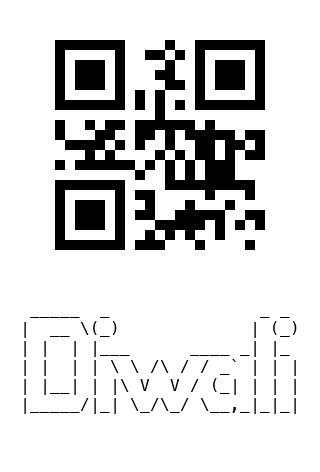

# ai-essentials-13b

Small Python programs for Worksheet 13b. Each release (v0.1, v0.2, v0.3) is its own commit.

## 1. What it does
`qr_banner.py` makes one PNG image with a QR code on top and a big text-art banner underneath it.

## 2. Which two libraries, and what each contributes
- **qrcode** makes the QR code image from the text.
- **pyfiglet** turns the caption into a big text-art banner (the `big` font).

Pillow (installed together with `qrcode[pil]`) is used to draw the banner text under the QR code and save the final image.

The earlier releases use one library each: `banner.py` (pyfiglet) and `make_qr.py` (qrcode).

## 3. What you need installed before running
- Python 3
- The packages in `requirements.txt`:

```
pip install -r requirements.txt
```

Note: plain `pip install qrcode` does not install Pillow. It needs `qrcode[pil]`, which is what `requirements.txt` has.

The program uses the Menlo font from macOS (`/System/Library/Fonts/Menlo.ttc`). On other systems it falls back to Pillow's default font and the banner may look different.

## 4. The exact command
```
python qr_banner.py
```

You can also give your own text: `python qr_banner.py "QR text" "Caption" output.png`

## 5. What the output looks like
It prints `saved qr_banner.png size (320, 472)` and creates `qr_banner.png`: the QR code on top (scans as "Happy Diwali") and the word "Diwali" written under it in big letters.



## 6. What it can't do yet
- It only works well with short captions. A long caption makes the banner wider than the QR code and the image gets wider.
- The font path is for macOS only.
- It does not check that the QR text is too long for a QR code.
- The banner font is fixed to `big`.

## Extra (homework): diwali_card.py
A fourth library, **rich**. `python diwali_card.py [name] [output.svg]` prints a small Diwali card (a panel and a table of the five days) in the terminal and saves it as `diwali_card.svg`. Install it with `pip install -r requirements.txt` (rich is now in the file). It only uses the text I typed in, so the festival days are fixed and not looked up.
